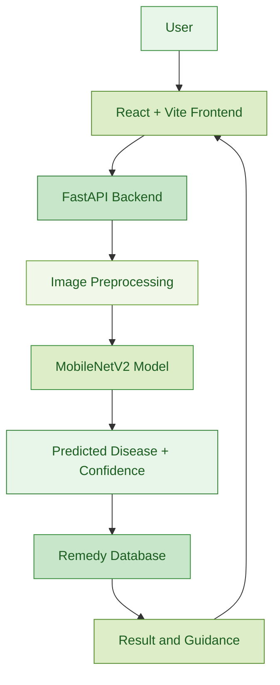
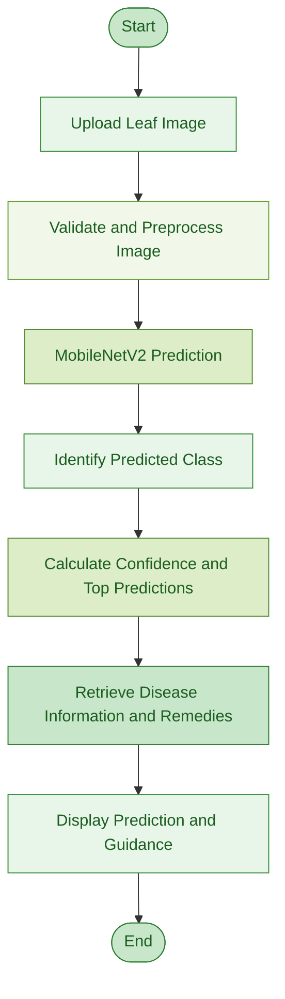

# PlantRx — Plant Disease Detection and Guidance System

PlantRx is a deep learning-based plant disease detection system that classifies leaf images and provides practical guidance for disease management. Developed as an M.Sc. Applied Data Science capstone project at SRM Institute of Science and Technology, the application combines image classification with a web interface and a structured remedy database.

The project aims to make preliminary plant disease identification more accessible by helping users analyse leaf images and understand possible treatment and prevention measures.

## Project Objectives

- Identify plant diseases from leaf photographs using deep learning.
- Compare pretrained convolutional neural network architectures for image classification.
- Provide predicted disease labels, confidence scores, and alternative predictions.
- Present relevant symptoms, treatment options, and preventive guidance.
- Integrate the trained model into a browser-based application.

## Key Features

- **Leaf image analysis:** Upload up to five leaf images for analysis.
- **Disease classification:** Predict one of the supported 38 crop-health classes.
- **Confidence reporting:** Display the prediction confidence and the three most likely candidates.
- **Remedy guidance:** Retrieve disease descriptions, symptoms, treatment options, and prevention advice from a structured database.
- **Plant information:** Provide plant species and growth-stage details to support the analysis workflow.
- **Weather-aware advice:** Display weather-related guidance where the required information is available.
- **Additional application features:** Include diagnosis history, an FAQ-style assistant, PDF report export, and language selection as described in the project report.

## Technology Stack

| Component | Technologies |
|---|---|
| Programming language | Python |
| Deep learning | TensorFlow, Keras |
| Model architectures | MobileNetV2, DenseNet121, EfficientNetB0 |
| Data processing | NumPy, Pandas, Pillow |
| Data visualisation | Matplotlib, Plotly |
| Development environment | Google Colab |
| Backend | FastAPI, Uvicorn, Pydantic |
| Frontend | React, Vite, JavaScript |
| Remedy storage | JSON or SQLite |
| Application packaging | Docker |

## Dataset

The project uses the cleaned PlantVillage dataset for plant leaf disease classification.

The data used in this project can be found on plantvillage-dataset(https://www.kaggle.com/datasets/abdallahalidev/plantvillage-dataset).

| Dataset characteristic | Details |
|---|---|
| Total images | 54,284 |
| Crop species | 14 |
| Classification classes | 38 |
| Training images | 37,982 |
| Validation images | 8,126 |
| Test images | 8,176 |
| Data split | 70:15:15 |
| Random seed | 42 |

The dataset contains healthy and diseased leaf images. Exploratory data analysis examined class distribution, image dimensions, and brightness variations to guide preprocessing and model development.

## Model Development and Comparison

Three ImageNet-pretrained convolutional neural network architectures were investigated using transfer learning.

| Model | Reported test result | Role in the project |
|---|---:|---|
| MobileNetV2 | Approximately 97% accuracy | Selected final model |
| DenseNet121 | Approximately 94% accuracy | Model comparison |
| EfficientNetB0 | Approximately 85.76% accuracy | Preliminary evaluation on a 22-class subset |

The EfficientNetB0 result is not directly comparable to the other two results because it was evaluated on a smaller subset of classes.

MobileNetV2 was selected as the final model because it combines strong classification performance with a lightweight architecture suitable for CPU-based inference.

## System Workflow

The application follows an end-to-end image classification workflow:

1. **Image upload:** The user uploads a photograph of a plant leaf.
2. **Preprocessing:** The image is validated, converted to RGB, resized, and normalised as required by the model.
3. **Disease prediction:** The trained MobileNetV2 model generates class probabilities.
4. **Result generation:** The application identifies the predicted class, confidence score, and leading alternative predictions.
5. **Remedy lookup:** The predicted class is used to retrieve relevant information from the remedy database.
6. **Result display:** The web interface presents the prediction and associated guidance.

### System Architecture

### System Workflow

## Project Limitations

- The classifier supports only the 38 classes represented in the training dataset.
- Performance on real-world field photographs may differ from performance on the test dataset.
- The model does not estimate disease severity or the affected leaf area.
- A prediction is not a substitute for professional agricultural diagnosis, particularly when confidence is low.
- Weather-related advice depends on the availability of the required weather information.

## Running the Application

The project report describes a FastAPI backend, a React frontend, and Docker-based packaging.

To run the application, use the configuration files and setup instructions included in the project repository. The exact environment variables, model files, dependencies, and service configuration should be verified against the supplied source code before deployment.

## Academic Project Information

**Project:** Plant Disease Detection System — PlantRx: Deep Learning-Based Leaf Disease Classification and Guidance

**Programme:** M.Sc. Applied Data Science

**Institution:** SRM Institute of Science and Technology, Kattankulathur, Chennai

**Project Team:**
- Sourish Halder
- Abhirup Urinda
- Om Desai
- Sanket Kurmi

## Future Improvements

Potential areas for further development include evaluating the model on diverse field photographs, expanding disease-class coverage, improving prediction reliability, and optimising the application for deployment in resource-constrained environments.

## Conclusion

PlantRx brings together deep learning, image processing, and a web-based guidance system to support preliminary plant disease identification. The project demonstrates how an image classification model can be integrated with structured information and a user interface to create a practical agricultural application.

*PlantRx is an academic project intended to support plant health assessment and does not replace expert diagnosis.*
